# Motorfolio architecture

This guide follows the app from a user's action to a durable record, calculated insight, backup, and Android package. It consolidates the implementation, design rationale, contracts, verification evidence, release process, limitations, and dependency notices. Start with the [README](../README.md) for installation and everyday use.

## Reading map

- [Product and architectural decisions](#product-and-architectural-decisions)
- [System and source structure](#system-and-source-structure)
- [Screens and user journeys](#screens-and-user-journeys)
- [Domain model and data contracts](#domain-model-and-data-contracts)
- [Loading, migrations, and durable saves](#loading-migrations-and-durable-saves)
- [Fuel, odometer, and cost calculations](#fuel-odometer-and-cost-calculations)
- [Attachments and device integration](#attachments-and-device-integration)
- [Reminders and notification lifecycle](#reminders-and-notification-lifecycle)
- [Transfer, backup, and unit conversion](#transfer-backup-and-unit-conversion)
- [Offline operation and local server](#offline-operation-and-local-server)
- [Security, privacy, and design](#security-privacy-and-design)
- [Development and verification workflow](#development-and-verification-workflow)
- [Verification and evidence](#verification-and-evidence)
- [Build, release, and recovery](#build-release-and-recovery)
- [Limitations and remaining acceptance](#limitations-and-remaining-acceptance)
- [Third-party notices](#third-party-notices)

## Product and architectural decisions

Motorfolio serves commuters logging fuel, households maintaining several vehicles, and owners keeping service/receipt/warranty history. Its central journey is **add a vehicle -> record actual activity -> review costs and upcoming care**, without an account or external vehicle API.

One React/TypeScript interface runs in browsers and Android. Capacitor hosts the Android WebView; native adapters provide SQLite, notifications, camera access, and file sharing. This preserves one set of screens and pure calculations across platforms. The initial preferred stack suggested React Native; this established project instead uses Capacitor. The tradeoff is WebView rendering and an explicit native bridge boundary. No iOS implementation is delivered.

| Decision | Reason | Consequence |
|---|---|---|
| React 19 + strict TypeScript | Shared interactive interface and typed contracts | UI and pure calculations can be tested independently |
| Zod validation | Reject malformed imports, invalid records, dangling references | External/saved data is validated before use and save |
| IndexedDB / native SQLite | Durable offline records without an account | Garages belong to an origin/profile or Android installation |
| Revision-checked JSON snapshot | Atomic garage updates and shared storage contract | Attachments enlarge the snapshot; large document libraries need another design |
| Capacitor adapters | Share UI while exposing required Android capabilities | Native behavior requires actual APK/runtime validation |
| Local Node server | Serve the browser build and health endpoint | No vehicle-record backend or cloud sync |
| CSV and encrypted backups | Explicit transfer/recovery without a hosted service | Owner retains files and passwords |

Presentation, pure business rules, and device/storage adapters have separate ownership. A screen cannot claim a successful save before the storage transaction succeeds.

## System and source structure

### Runtime containers

The browser receives its shell from the local server; Android bundles that shell in the APK. Records go directly through the selected local adapter, never through an HTTP data endpoint.

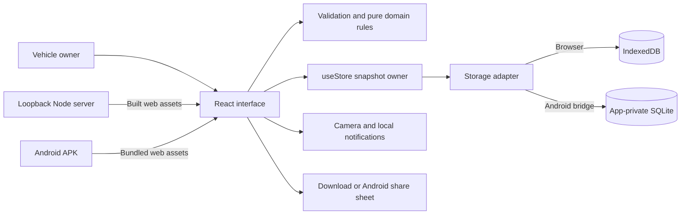

### Source ownership

| File or area | Responsibility |
|---|---|
| [`src/main.tsx`](../src/main.tsx) | Mount React, bundled fonts/styles, service-worker registration |
| [`src/App.tsx`](../src/App.tsx) | Hash navigation, selected vehicle, dialogs, confirmations, durable mutations, notification resynchronization |
| [`src/ui.tsx`](../src/ui.tsx) | Shell, semantic controls, dialogs, hints, empty states, charts, skip link, export errors |
| [`src/Dashboard.tsx`](../src/Dashboard.tsx), [`src/Reports.tsx`](../src/Reports.tsx) | Derived summaries, trends, category/monthly reporting |
| [`src/Forms.tsx`](../src/Forms.tsx), [`src/RecordFields.tsx`](../src/RecordFields.tsx) | Draft forms and selected-vehicle fields |
| [`src/recordCommands.ts`](../src/recordCommands.ts) | Build validated records, activity rules, attachment retention, entry order |
| [`src/Records.tsx`](../src/Records.tsx) | Activity filtering/export; display/complete/reopen/edit/delete reminders |
| [`src/Warranties.tsx`](../src/Warranties.tsx), [`src/warranty.ts`](../src/warranty.ts) | Coverage forms, schema, status, receipts |
| [`src/domain.ts`](../src/domain.ts), [`src/contracts.ts`](../src/contracts.ts) | Schemas/migration, stable IDs, odometers, MPG, reminder status, cost calculations |
| [`src/useStore.ts`](../src/useStore.ts), [`src/storage.ts`](../src/storage.ts) | Readiness/revisions, overlapping-save guard, persistence, file validation/export |
| [`src/AttachmentField.tsx`](../src/AttachmentField.tsx) | Camera/import UI, size/type checks, errors, selected-file handoff |
| [`src/transfer.ts`](../src/transfer.ts), [`src/units.ts`](../src/units.ts) | CSV, encrypted full transfer, complete distance conversion |
| [`src/Settings.tsx`](../src/Settings.tsx) | Preferences, reviewed transfer/deletion/conversion, permission and scheduling |
| [`server/index.mjs`](../server/index.mjs) | Loopback static build, security headers, health |
| [`MainActivity.java`](../android/app/src/main/java/com/portfolio/motorfolio/MainActivity.java) | Register native storage, system text scale, Back with an open dialog |
| [`LocalVaultPlugin.java`](../android/app/src/main/java/com/portfolio/motorfolio/LocalVaultPlugin.java) | SQLite transactions, restricted-cache file export/share |

Dependency direction keeps pure domain code independent of React and Android. This diagram shows runtime calls, excluding TypeScript-only type imports.

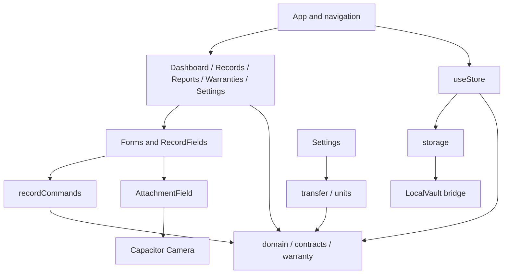

### State ownership

- **Durable:** `useStore` owns the validated saved snapshot, revision, readiness, and load errors.
- **Transient:** React owns drafts, files, selected vehicle, filters, screen, notices, busy flags, and confirmation dialogs.
- **Derived:** odometer, MPG, coverage/reminder status, monthly totals, and ownership cost are calculated from records, not independent stored facts.
- **OS:** Android owns permission, camera activity, notification delivery, and share-sheet lifecycle. A stored preference does not establish OS permission.

## Screens and user journeys

Routes use URL hashes; screen changes need no server routes. Overview uses the selected vehicle; activity/warranty/reporting screens explicitly choose their own scope/filter.

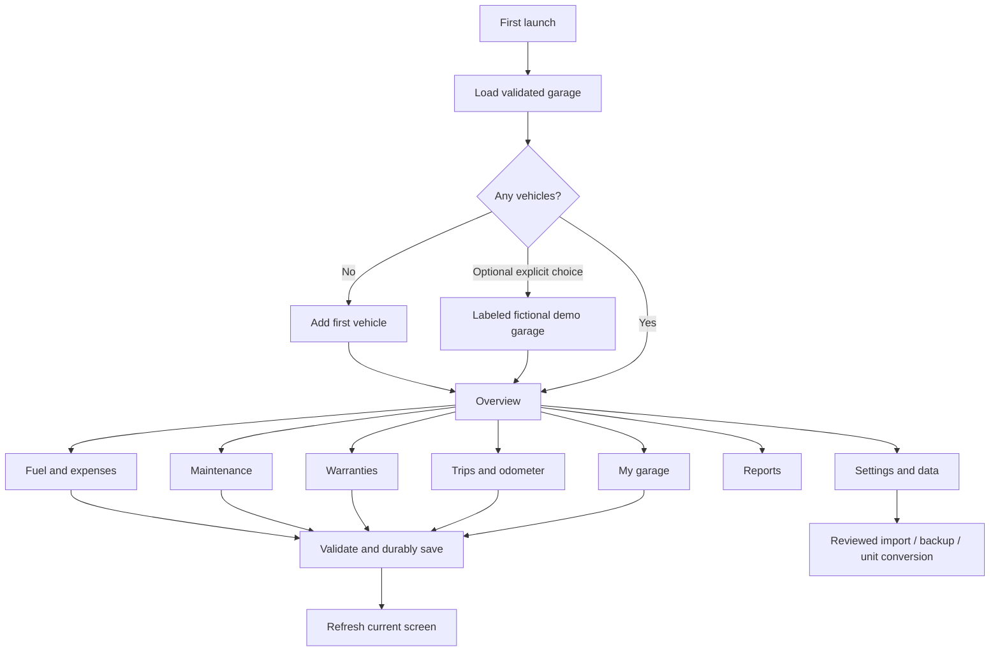

| Screen | Main interaction | Empty/error behavior |
|---|---|---|
| Overview | Select vehicle, log activity, trends, upcoming work | First-vehicle onboarding; insufficient-data chart |
| My garage | Add/edit/view/delete vehicle | Empty garage; confirmation before cascading deletion |
| Fuel & expenses | CRUD, text/type/category/vehicle/date filters, export | No matches; invalid activity rejected |
| Maintenance | Date/mileage reminders; complete/reopen/edit/delete | At least one due limit; calendar works with permission denied |
| Warranties | Provider/terms/limits/receipt; filter/edit/delete | No records; reversed coverage dates rejected |
| Trips & odometer | Start/end readings and corrections | Invalid distance/rollback rejected |
| Reports | Monthly/category costs in reporting currency | Missing months omitted; no invented costs |
| Settings & data | Preferences, permission, backup/import, conversion, deletion | Reviewed destructive actions; visible errors |

## Domain model and data contracts

JSON schema **version 2** contains `vehicles`, `entries`, `schedules`, `warranties`, `settings`, and a `demo` flag. New records use UUIDs. Each entry/schedule/warranty references a real vehicle; duplicate IDs and dangling references reject. Collection limits: 100 vehicles, 20,000 entries, 2,000 schedules, 2,000 warranties.

These are logical JSON relationships, not separate SQLite tables:

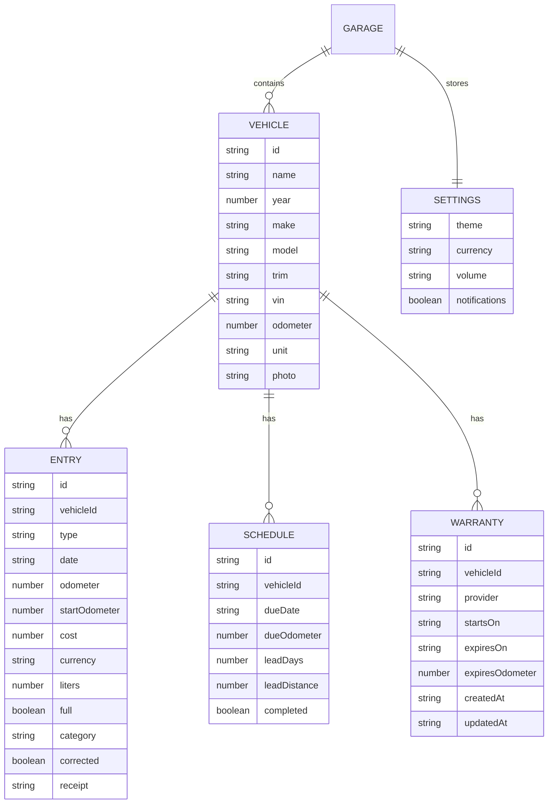

Entries also retain title/provider/notes, correction reason, and optional receipt filename. Warranties also retain title/reference, terms, lead times, receipt/filename. Warranty audit timestamps are UTC instants; owner-entered fuel/service/trip dates are calendar dates, not telemetry timestamps. Presentation localizes dates without inventing measurement times.

Fuel is canonical **liters**; odometers use the vehicle's current **mi/km** unit. Conversion changes every distance reference together. Currency remains per entry (USD/EUR/GBP/INR); reports filter rather than convert. Receipt/photo bytes are validated local data URIs.

## Loading, migrations, and durable saves

### Initial load

Container version and payload version differ: IndexedDB and SQLite containers remain version 1; stored garage JSON is validated as version 2.

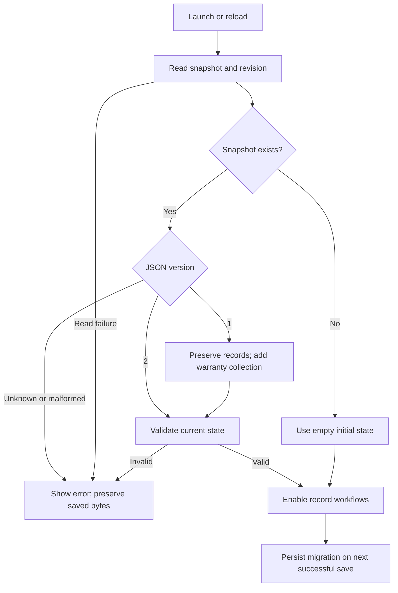

Unknown/corrupt data never resets silently to empty/demo data. Retry reloads the source. Future migrations must explicitly transform a known validated schema. Back up before updating/clearing data.

| Runtime | Container | Value |
|---|---|---|
| Browser | IndexedDB `private-workspace-v1`, store `snapshots`, key `state` | `{ revision, value }` |
| Android | App-private `workspace.db`, table `snapshot` | One row: revision and serialized snapshot |

```sql
CREATE TABLE snapshot (
  id INTEGER PRIMARY KEY CHECK(id = 1),
  revision INTEGER NOT NULL,
  json TEXT NOT NULL
);
```

### Atomic save and conflicts

Forms construct a proposed garage. Domain checks run before persistence; a transaction compares stored/expected revisions and commits only if they match. A stale browser tab cannot silently overwrite a newer save.

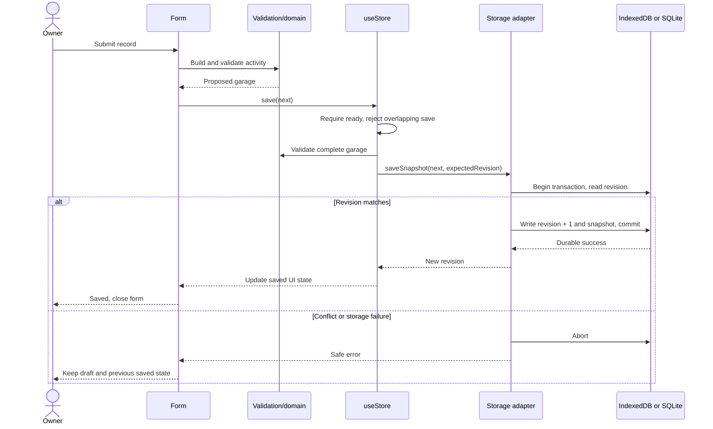

There is no in-memory success fallback. `useStore` rejects writes before readiness or during an overlapping submission. Confirmed vehicle deletion removes related entries/schedules/warranties/current attachment references in the same proposed snapshot.

## Fuel, odometer, and cost calculations

### Full-fill intervals

A baseline full fill marks the starting odometer; its purchased fuel does not count toward the following interval. Later partial fills accumulate fuel until the next full fill. Only positive distance and positive fuel produce a reading.

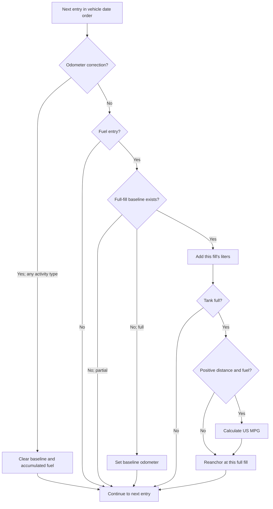

`US MPG = distance in miles / (liters / 3.785411784)`. Example: full at 1,000 mi, 5 gal at a partial fill, then 5 gal when full at 1,300 mi produces `300 / 10 = 30 MPG`. An unanchored partial fill or an interval crossing an odometer correction produces no reading.

### Odometer and ownership rules

- Completed activities cannot be future-dated. Fuel must be positive. Trip ending odometer must exceed its start.
- A correction requires a reason and starts a new timeline segment. Ordinary readings must agree with surrounding readings in that segment.
- Calendar-date ordering retains saved order on the same day. Editing preserves position; enter historical same-day corrections in their intended sequence.
- Current odometer uses the latest activity, or the baseline with no activity.
- Ownership totals include entries in the reporting currency only. Cost per mile uses the recorded odometer span converted to miles, without purchase/depreciation assumptions. It is unavailable with insufficient distance or corrected history.
- Monthly totals group actual entries by month/currency. Missing months are omitted. Fuel trends sample valid full-fill intervals, not timed telemetry.

Charts identify units and expose samples in accessible labels. A `null` sample creates a gap; an unavailable series shows an empty state.

## Attachments and device integration

Attachments are local record data. Import checks allow PNG/JPEG/WebP/PDF only, up to 3,000,000 bytes each. File inputs are explicitly captured into FormData; captured photos use the same record validation/persistence path.

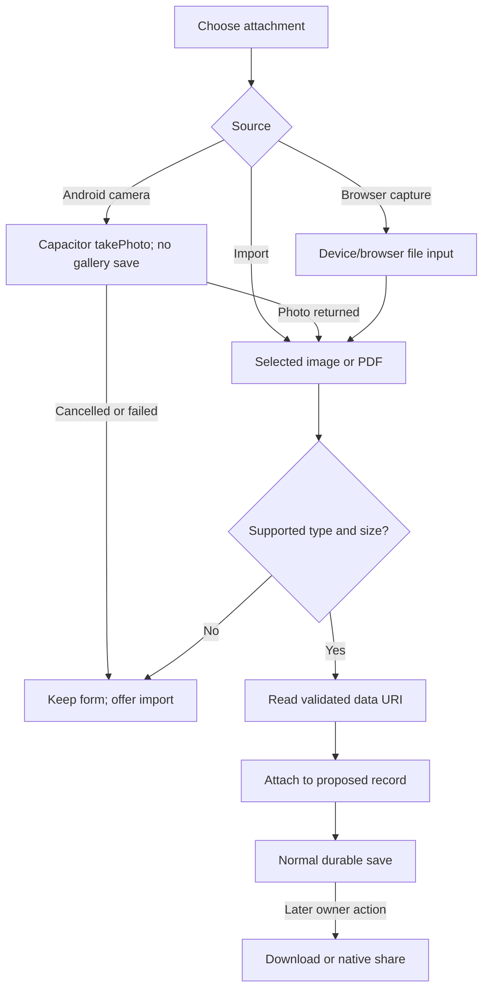

Android `LocalVault.exportFile` sanitizes filenames, writes under app cache `exports/`, grants a FileProvider content URI, and opens a share chooser. Storage/share failures are visible. Opening the chooser does not send a file automatically. Browser exports use download links and revoke generated object URLs.

`MainActivity` registers `LocalVaultPlugin`, maps WebView text zoom to Android font scale, and intercepts hardware Back for an open dialog. Cancellation keeps the app usable; otherwise Back delegates to Capacitor.

## Reminders and notification lifecycle

A maintenance schedule needs a date, positive odometer limit, or both. Zero odometer means no mileage limit; an empty date supports mileage-only scheduling. Completion overrides warnings. Date/distance lead times determine scheduled/due-soon/overdue presentation. Warranty status also considers coverage start and entered expiry limits.

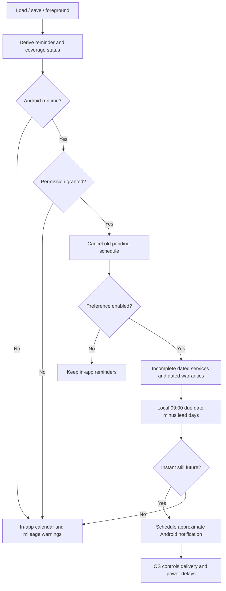

Permission is requested only after the owner's settings action. Denial leaves records/calendar available. Mileage warnings update from manual odometer data; no GPS/background driving monitor exists. Past lead instants remain in-app rather than being scheduled at an invalid time. Exact-alarm permission is not requested.

## Transfer, backup, and unit conversion

### CSV and full backups

CSV transfers activities; encrypted backup transfers the entire workspace. The import dialog explains the distinction before confirmation.

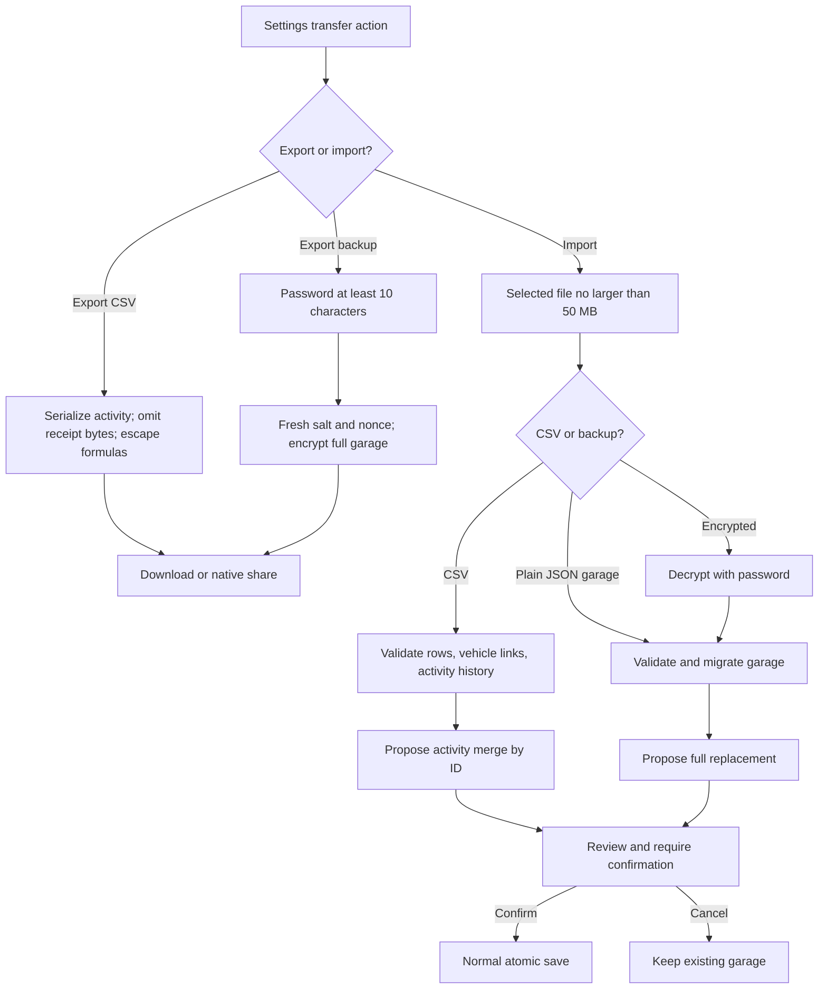

Web Crypto uses **PBKDF2-SHA256, 250,000 iterations**, to derive an **AES-256-GCM** key from a fresh 16-byte salt. Each backup uses a fresh 12-byte IV. Its envelope contains `format: motorfolio-aes256-v1`, base64 salt/IV, and encrypted data. Password/key never go to a service. Wrong passwords, corrupt envelopes, and invalid restored records reject without replacement. There is no password recovery.

CSV requires matching vehicle IDs in the destination. Export one to inspect exact columns: canonical `liters`, boolean full/corrected flags, optional trip-start/receipt-name values, and activity metadata. Import validates rows/history, merges by ID, then validates the complete garage. Receipt bytes, vehicles, schedules, warranties, and preferences use a full backup.

### Distance conversion

After confirmation, a unit change builds a complete converted snapshot and saves it atomically. Cost/currency/canonical fuel quantities remain as recorded.

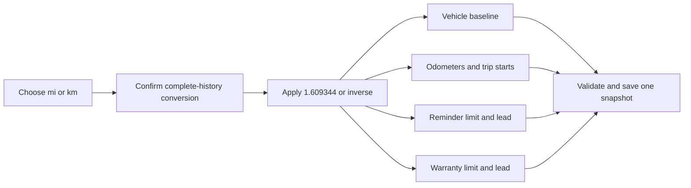

## Offline operation and local server

The browser service worker caches the shell/bundled assets after first load. Cache identity includes a built asset-name hash; activation removes older caches. GET requests fall back to cached content offline. `/api/` bypasses that fallback. Android loads APK-bundled assets and SQLite without Node.

Browser/Android garages are independent; browser origins/profiles are also independent. Encrypted backup is the explicit transfer path. No installation silently syncs with another.

Node binds `127.0.0.1`, default port **5181**. `PORT` can be set in the process environment; helpers/QA use the documented default. The server accepts `localhost`/`127.0.0.1` Host values, contains asset paths under `dist/`, and adds CSP, `nosniff`, and referrer-policy headers. There is no HTTP record backend or account/auth service.

| Contract | Input | Result |
|---|---|---|
| Health | `GET /api/health` | HTTP 200 JSON `{"status":"ok","app":"Motorfolio"}` |
| Shell | `GET /` | `dist/index.html` and same-origin assets |
| Native load | `LocalVault.load()` | `{ json: string or null }`; JSON includes snapshot revision/value |
| Native save | `LocalVault.save({ json, expected })` | Commit or conflict/storage rejection |
| Native export | `LocalVault.exportFile({ name, content, type, base64? })` | Restricted cache file/share chooser or visible failure |

Storage writes do not use the health endpoint. HTTP health verifies server reachability, not successful record persistence.

## Security, privacy, and design

### Permission and threat boundaries

| Area | Control | Failure/denial behavior |
|---|---|---|
| Records | App-private SQLite / origin-private IndexedDB; revisions | Preserve prior saved state |
| Imports | Zod, collection limits, referential checks, reviewed replacement | Reject corrupt input; no silent reset |
| Attachments | MIME/data-URI validation; 3 MB per-file limit | Keep draft and offer another file |
| Camera | User-invoked capture; no gallery save/broad storage access | Import remains available |
| Notifications | Optional POST_NOTIFICATIONS; no exact alarm | Calendar stays useful |
| HTTP | Loopback, Host/path checks, CSP, nosniff | Refuse invalid hosts/paths |
| Native files | Sanitized filename, restricted FileProvider cache path | No arbitrary export path; errors surfaced |
| Backup | Authenticated AES-GCM encryption | No hosted password recovery |
| Deletion | Confirm clearing/replacing; cascade vehicle references | Exported files remain independent |

This is a single-owner workspace. Someone with OS-user/browser-profile/unlocked-device access may read local records. App-private storage is not application-level database encryption; at-rest protection depends on the OS/device. Android cloud backup is disabled. No ads, analytics, crash uploads, or VIN decoding are present. Vehicle telemetry, manufacturer intervals, FX, and depreciation are never fabricated.

Retention ends at explicit deletion, site/app-data clearing, or uninstall. Removing snapshot references is not a forensic secure erase. Downloaded/shared files and OS-managed cache copies are separate. Verify a full backup before deleting or replacing the original garage.

### Interface rationale

The design is a daylight utility workspace: warm paper/forest tokens, restrained borders, readable numerals, an original sedan SVG, and optional dark mode. DM Sans Variable and Instrument Serif are bundled, with no font-service requests. Existing design notes considered palette/navigation/motion patterns from Realtime Colors, 21st.dev, and Motion; reference-site layouts/code are not included.

Shared primitives provide semantic buttons, named icon actions, associated hints, confirmations, skip navigation, empty/loading/error states, and reduced motion. Native CSS handles simple feedback. Narrow screens use a horizontally scrollable navigation strip; short desktop landscape windows allow sidebar scrolling. Tables scroll within wrappers. Dialogs support cancellation/Escape/Android Back; native text zoom follows system scale.

## Development and verification workflow

Work is organized as complete journeys: navigation/onboarding, durable records, trustworthy insights, device/transfer adapters, then runtime validation and packaging. Future changes should extend the layer owning their behavior rather than duplicate calculations in screens.

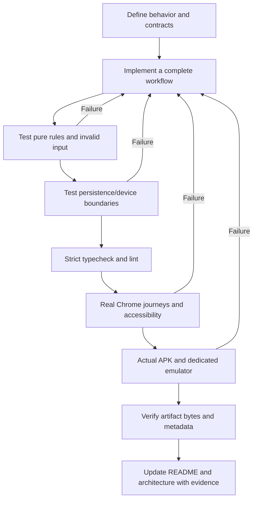

[`package.json`](../package.json) defines commands. Coverage includes configured `src/**/*.{ts,tsx}` with **90% lines/statements/functions/branches**. V8 does not measure Java. DOM tests label IndexedDB/native/permission doubles; browser tests use real Chrome storage; Android tests inspect real SQLite with `adb run-as`.

[CI](../.github/workflows/ci.yml) defines lint/coverage/web build/production audit and JDK 21/SDK 36 packaging/artifact upload jobs. The build's TypeScript step also checks types. Configured CI is separate from a claim that hosted CI has run.

## Verification and evidence

Final application validation: **2026-11-05, America/Chicago**. Evidence files are generated locally and git-ignored; documented commands regenerate them.

| Check | Observed result | Evidence/repeat command |
|---|---|---|
| Static and automated behavior | TypeScript/ESLint passed; **41 tests in 13 files** passed | `npm run check`; `qa/coverage-current.log` |
| TypeScript coverage | **97.99% lines, 96.72% statements, 94.8% functions, 90.56% branches** | `npm run test:coverage`; `coverage/coverage-summary.json` |
| Critical pure rules | Domain/warranty modules reached 100% in all four measured metrics | Coverage evidence, not proof of all possible correctness |
| Chrome | **16 checks passed**, zero uncaught page errors | `npm run test:browser`; `qa/browser-check.json`, `qa/ownership-check.json` |
| Accessibility | Zero automated violations on all eight screens in both themes | `qa/accessibility-all-screens.json` |
| Browser layouts | All screens at 320x900, 900x420, 768x1024 without page overflow | Ownership browser suite |
| Android | **13 checks passed** on Android 15/API 35 dedicated emulator | `npm run test:android`; `qa/android-check.json` |
| Packaging | Debug/release builds, debug signature/metadata/hash, packaged asset matching passed | `qa/android-build-current.log`, `qa/apk-metadata.txt`, `qa/apk-signature.txt` |
| Clean installation | Isolated source/lockfile copy: npm ci and npm run check passed | `qa/verification-summary.json`, `qa/fresh-install-path.txt` |
| Audit | Zero production vulnerabilities; seven moderate dev-tool findings; no high/critical findings in recorded full audit | `qa/dependency-audit.json` |
| Local HTTP | Root and health returned HTTP 200 | `http://127.0.0.1:5181/api/health` |

### Behavior matrix

| Case | Runtime and steps | Expected | Actual | Evidence |
|---|---|---|---|---|
| First run/fuel CRUD/relaunch | Chrome: add vehicle, save/edit/filter/delete fill, reload | Durable values, confirmed deletion | Pass | Browser results |
| MPG full/partial/zero/negative/correction | Domain fixtures, including non-fuel correction | Valid anchored intervals only | Pass | `tests/domain.test.ts`, `tests/regressions.test.ts` |
| Migration/warranty receipt | DOM/storage: load v1, save warranty/PDF | Retain legacy records, persist v2 | Pass | `tests/warranties-ui.test.tsx` |
| Receipt import and camera | Chrome PDF download; Android actual camera and SQLite readback | Correct retained bytes/record | Pass | Browser/native results |
| Backup/restore | Chrome: encrypt/download/review/restore warranty/receipt garage | Full roundtrip; confirmation first | Pass | Ownership results |
| Unit conversion | Domain/Chrome: confirm mi/km, relaunch | Convert all matching distances; retain other vehicle/costs | Pass | Regression/ownership results |
| Mileage-only reminder | Domain/Chrome: empty date, positive limit | Valid entry; no invalid date scheduling | Pass | Ownership results |
| Rollback/invalid input | Domain/DOM: future entry, invalid trip, missing correction reason | Reject and retain draft | Pass | Domain/UI tests |
| Permission/delivery | Android: deny, retain usability, grant, schedule QA notification | Records usable; real OS delivery | Pass | Native results |
| Offline | Chrome offline; Android airplane mode, edit/save | Durable local edits | Pass | Browser/native results |
| Storage/corrupt/stale writer | Explicit boundary doubles and IndexedDB transaction tests | Prior state retained; visible error | Pass | `tests/storage-extra.test.ts`, `tests/hook-extra.test.ts` |
| Keyboard/Back | Chrome skip-link/Enter/Escape; Android Back on form | Correct focus/cancellation | Pass | Browser/native results |
| Native persistence | Force-stop/relaunch and actual SQLite readback | Records retained | Pass | Native results |
| Native larger text/landscape | 150% font scale; rotate, navigate, open/cancel form | Usable controls, no overflow | Pass; screenshot reviewed | Native results |
| Physical/OEM/TalkBack matrix | Physical hardware required | Target-device/manual acceptance | Not tested | Remaining acceptance below |

Native QA targets `emulator-5582`, dedicated AVD `PortfolioApps_QA_20261105`, Android 15/API 35, model `sdk_gphone64_x86_64`. It installs the actual APK, creates QA records, tests this app's permission, opens camera/share UI, and temporarily changes airplane mode/font scale/rotation. Display/connectivity settings are restored; records are retained for persistence checks. Never target a personal phone. Camera automation uses the stock `com.android.camera2` activity. Its image is an emulator fixture, not a physical receipt or sensor reading. Nothing is sent from the share sheet.

Five isolated first-run Chrome samples observed **136-252 ms LCP**; one emulator cold activity launch reported **1,908 ms**. These are local observations, not field p75 or physical-device/battery benchmarks. Raw results: `qa/browser-performance.json`, `qa/android-memory.txt`.

| Generated screenshot | View |
|---|---|
| `qa/desktop.png`, `qa/mobile-320.png`, `qa/dark.png` | Overview layouts/themes |
| `qa/warranties.png` | Coverage terms and receipt |
| `qa/android-api35.png`, `qa/android-webview.png` | Actual native/WebView capture |
| `qa/android-landscape-large-text.png` | Landscape with 150% text scale |

## Build, release, and recovery

### Toolchain and flow

Tested: Windows, **Node 22.13.1**, **npm 10.9.2**, **JDK 21.0.11**, SDK platform/build-tools **36**, Gradle **8.14.3**, AGP **8.13.0**. `.nvmrc` records Node; the lockfile pins dependency versions. Replace any inherited JDK 17 `JAVA_HOME` with JDK 21 before native builds.

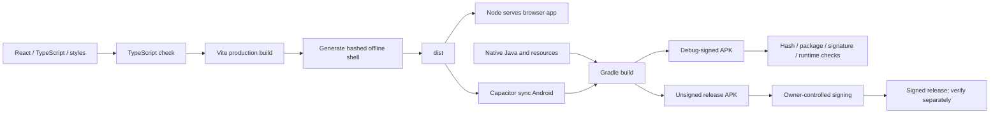

`npm run android:build` builds the web app, runs `npx cap sync android`, then `android/gradlew.bat assembleDebug assembleRelease --console=plain` on Windows (the corresponding wrapper elsewhere). Original outputs are under `android/app/build/outputs/apk/`; the script copies them to `artifacts/`, hashes them, and records metadata. A build alone does not establish installation success.

### Verified artifacts

Package `com.portfolio.motorfolio`, versionName **1.0.0**, versionCode **1**, min SDK **26**, target/compile SDK **36**:

| Artifact | Bytes | SHA-256 | Validation |
|---|---|---|---|
| `artifacts/motorfolio-1.0.0-debug.apk` | 10049052 | `6e2c9e36d4d907d2b3b75d024e24a43bfdf9d29aed1aff1841d9974d732690ee` | Debug signature v2; installed/launched with 13 passing emulator checks |
| `artifacts/motorfolio-1.0.0-release-unsigned.apk` | 6813766 | `5dec00c3ab849fb2943cc4a1ae6bb7075fc0e63ee4eeaa63424209ad3eae15c5` | Built; unsigned, not claimed as installed/distributable |

`artifacts/build-evidence.json` and `.sha256` sidecars are authoritative for each new build; rebuilds can change hashes. The verified debug APK's web asset bytes matched `dist/`. Inspect with SDK `aapt2 dump badging` and `apksigner verify --verbose` (Windows: `aapt2.exe`, `apksigner.bat`). Install debug with `adb install -r` and launch `com.portfolio.motorfolio/.MainActivity`, selecting an exact serial when needed.

### Signing and acceptance

Use Android Studio **Build > Generate Signed Bundle / APK** on `android/` with the owner's keystore **outside Git**. CI signing needs protected secrets and an explicit release signing configuration; verify the signed result separately. No production key/password was created by this work.

1. Fresh source/lockfile copy: `npm ci`, `npm run check`, `npm run test:coverage`.
2. Start server; verify root/health; run `npm run test:browser`.
3. JDK 21/SDK 36: build both APK variants and inspect hashes/package/signature.
4. Dedicated booted emulator and `ANDROID_SERIAL`: `npm run test:android`.
5. Complete physical-device/manual accessibility/OEM acceptance and production signing before public distribution.

The clean-install run used an isolated copy of current source/lockfile, not a published Git clone. No commits or pushes were made.

### Recovery

Back up before updates, clearing records, or uninstalling. JSON v1 migrates to v2; unknown versions reject. The old v1 APK predates structured warranties and must not roll back a v2 garage without a verified compatible recovery path. Do not uninstall a data-bearing app to downgrade without an exported, tested backup.

For web rollback, restore a compatible build and restart its owned server. Service-worker cache identity changes with asset names. Restore a garage through reviewed backup import. Local storage is not a replacement for backups, and shared/downloaded files survive local deletion.

## Limitations and remaining acceptance

| Area | Boundary/outstanding work |
|---|---|
| Physical devices | No physical phone connected. Installation/relaunch, Android 12-16/OEM matrix, real camera quality, TalkBack, battery use, target-hardware performance unverified. |
| Accessibility | Automated scans/emulator scale checks are scoped evidence, not complete WCAG certification or manual screen-reader/zoom assessment. |
| Notifications | Approximate Android delivery; past lead instants remain in-app. Mileage needs manual updates. No exact alarm, driving monitor, browser background date scheduler. |
| Metrics | US MPG; no FX/depreciation/purchase-cost inference or telemetry. Same-day historical corrections need intended entry order. |
| Storage | Snapshot attachments suit personal logs, not large libraries. Per-file cap 3 MB; restore cap 50 MB. Verify backup size/restore before deleting originals. |
| Deletion | Shared/downloaded files and OS cache copies are not secure-erased by deleting records. |
| Platforms/release | React/Capacitor differs from suggested React Native. No iOS/Play Store delivery. Release APK needs production signing. |
| Tool security | Recorded audit: seven moderate dev-only TypeScript ESLint/minimatch findings; zero production vulnerabilities, no high/critical findings. |
| External checks | Hosted CI, SonarQube, penetration testing, complete transitive-license audit, visual-regression baselines not executed. |

These limits are separate from completed implementation and local verification. A build/emulator pass does not establish physical-device or public-distribution acceptance.

## Third-party notices

Metadata below comes from installed direct runtime/platform manifests. Upstream license texts remain in package distributions and `node_modules`; this table does not replace applicable notices or establish a complete transitive audit. Reference-site layouts/code were not copied. The sedan illustration and launcher vector assets were authored for the app.

| Package | Installed version | Declared license |
|---|---|---|
| @capacitor/android | 8.6.0 | MIT |
| @capacitor/core | 8.6.0 | MIT |
| @capacitor/camera | 8.2.6 | MIT |
| @capacitor/local-notifications | 8.0.1 | MIT |
| @fontsource-variable/dm-sans | 5.2.8 | OFL-1.1 |
| @fontsource/instrument-serif | 5.3.0 | OFL-1.1 |
| lucide-react | 0.468.0 | ISC |
| papaparse | 5.5.3 | MIT |
| react | 19.2.0 | MIT |
| react-dom | 19.2.0 | MIT |
| zod | 4.6.7 | MIT |
